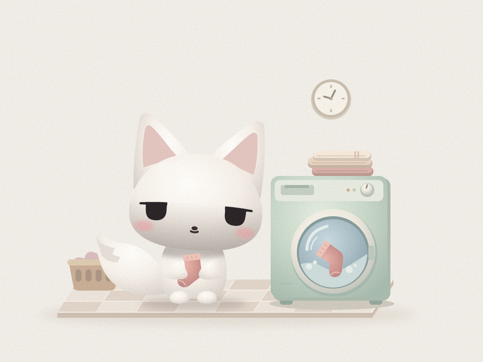
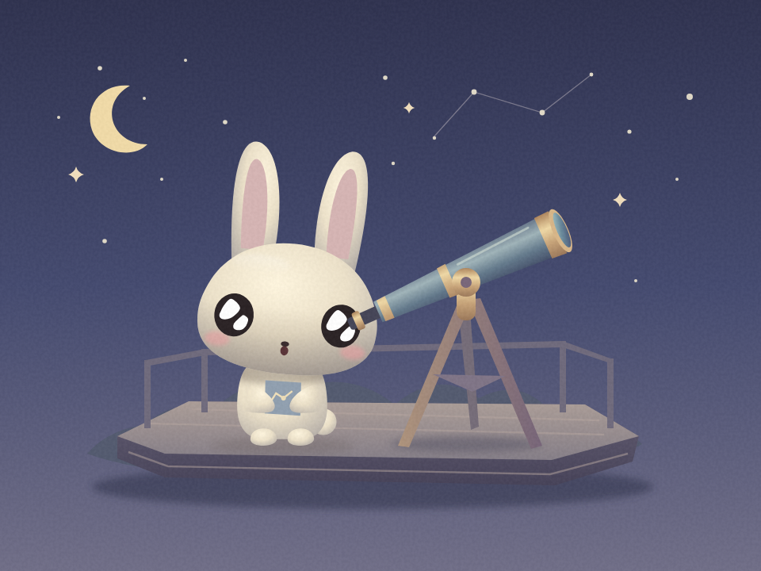
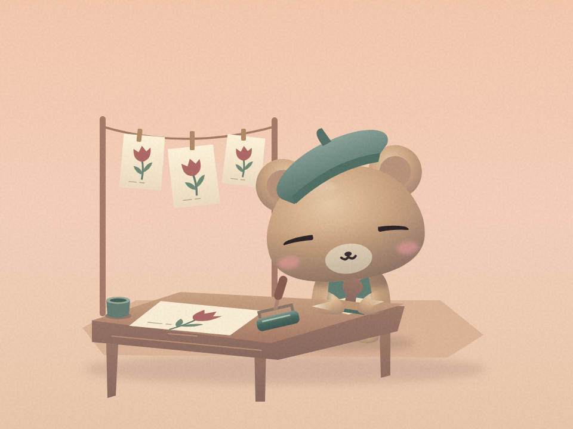

# Mochi Chibi · 馒头小动物 SVG

| 洗衣房的小狐狸 | 月升观星台 | 郁金香版画工坊 |
|:---:|:---:|:---:|
|  |  |  |

**聊天窗**只需上传 `SKILL.md`，告诉它动物、动作和场景。入口内含角色比例、双块异形高光、十一种眼型、腕根渐隐与圆弧脚底的画法。想从现成卡片改起，可以附上 `references/template.svg`。

**本地生成**用 `scripts/mochi.mjs` 组装角色和配件，`scripts/build-examples.mjs` 展示单角色、夜景和野餐群像。运行 `node scripts/build-examples.mjs` 可重建三张基础示例。`scripts/render.mjs` 用 Playwright 渲染 PNG，`scripts/lint.mjs` 检查 SVG。

背景色随场景自由选取，支持纯色和渐变。浅色、深色夜空和鲜明色块都可以，选色时检查角色与背景的明暗关系。

常规插画默认画成角色小景：先给角色一个能站、坐或靠的地方，让周围露出底色。角色拿着的东西放下后，也能看出它在哪里。明确要单体贴纸或头像时按指定取景。整张图共用一层极淡的单色底纹，脸部阴影用平滑渐变；生成脚本可在 `card` 的最后一个选项中设置 `canvasTexture: false` 关闭底纹。

## 配饰、道具与精度

配饰通常 1–2 件，主题造型需要时可以增加。场景道具没有件数上限，按画面空间、前后遮挡和主题选择。简单的馒头猫也可以抱结构完整的古董茶壶。

物品逐件定精度。**简洁**适合远处的小物，靠剪影和必要的留空识别；**标准**适合佩戴和使用中的物件，画清连接、厚度与接触；**精致**适合主体道具，可以展开壶盖嵌合、双端把手、瓷釉与彩绘。蝴蝶结的褶皱收进结心，蕾丝孔随布边转折，能透出后面的颜色。

例如：“馒头猫在旧茶铺倒茶。猫脸极简；主角茶壶精致，近处杯碟标准，后排茶罐简洁。”

## 微调与验收

比例、色阶和构图参数在 `style.json`。修改角色默认画法时，同步 `SKILL.md` 的独立画法、`scripts/mochi.mjs` 的生成器和模板中对应的形状。默认普通亮眼用 `double`，明确指定的三圆点星星眼用 `sparkle`。渲染后先看卡片原尺寸，再放大眼睛、腕根、脚底和主体道具的接触位置。
